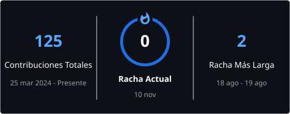

<!-- ⚠️ Archivo generado automáticamente desde perfil.json. No lo edites a mano: edita perfil.json. -->

# Cristian Gutiérrez

### Coordinador · Fundador de Gutierrez Systems

> QA y desarrollo de software para convertir operaciones reales en soluciones digitales.

    

---

## Sobre mí

Estudiante de octavo semestre de Ingeniería en Desarrollo de Software (CIAF) con formación en aseguramiento de calidad bajo ISTQB CTFL v4.0. Antes de dedicarme al software coordiné operaciones de servicios para el Municipio de Dosquebradas con equipos de hasta 113 personas, donde automaticé reportes, novedades y control operativo. Hoy combino esa visión operativa con QA y desarrollo para construir soluciones que resuelven problemas reales.

📍 Dosquebradas, Risaralda, Colombia · Remoto o presencial en Pereira / Dosquebradas

---

## Habilidades

| Área | Herramientas |
|---|---|
| **QA** | Diseño de casos de prueba · Reporte y seguimiento de defectos · BDD con Gherkin · Pruebas de API con Postman / Newman · Pruebas responsive · Seguridad básica (XSS, exposición de credenciales) |
| **Lenguajes** | JavaScript · TypeScript · Python · SQL |
| **Desarrollo** | React · Next.js · Node.js · Angular · HTML · CSS · FastAPI · Vite |
| **Bases de datos** | PostgreSQL · MySQL · MongoDB · Supabase |
| **Herramientas** | Git · GitHub · GitHub Actions · Vercel · Jira · Notion · Scrum |

---

## Trabajo seleccionado

- **[QA Portfolio](https://github.com/GCrist1an/qa-portfolio)** — 🟢 Publicado
  Plan de pruebas, 35 casos de prueba, 7 reportes de bugs reales de un e-commerce en producción, escenarios Gherkin y colección Postman con pruebas automatizadas de API.
  **Stack:** Postman · Newman · Gherkin · Markdown
- **[Makeupstore By Andrea](https://andreamakeupcare.shop)** — 🟢 En producción
  Catálogo interactivo con carrito, notas por producto, cierre de pedido por WhatsApp y panel de administración que publica cambios vía la API de GitHub.
  **Stack:** JavaScript · Vercel · API de GitHub
- **GS ContractOps** — 🟡 En desarrollo
  Plataforma para planear, ejecutar y supervisar contratos con operación en campo.
- **Aplicación de cierre de nómina** — 🔒 Privado
  Aplicación privada para asistencia, novedades y revisión de nómina en una empresa de servicios.
  **Stack:** Next.js · TypeScript · React · Supabase
- **[Aquality](https://github.com/Parra9510/aquality)** — 🤝 Colaboración externa
  Colaboración técnica en un proyecto externo de acuicultura. El repositorio no pertenece a Gutierrez Systems.

> Parte de los proyectos de Gutierrez Systems son privados, por eso la actividad visible puede no reflejar todo el trabajo realizado.

---

## Principios de ingeniería

- ✅ **Seguridad por defecto.** Secretos fuera del repositorio y exposición mínima de datos sensibles.
- ✅ **Calidad verificable.** Probar antes de entregar: casos de prueba, evidencia y trazabilidad.
- ✅ **Entrega trazable.** Rama → Pull Request → checks → `main`.
- ✅ **Evidencia real.** No presentar métricas, productos ni resultados sin respaldo.
- ✅ **Problemas reales primero.** Cada sistema responde a una necesidad operativa concreta.

---

## Gutierrez Systems

Software · QA · Automatización · Operaciones digitales — [www.gutierrezsystems.online](https://www.gutierrezsystems.online/) · [Organización en GitHub](https://github.com/Gutierrez-Systems)

---

Última actualización del perfil: 2026-11-07
